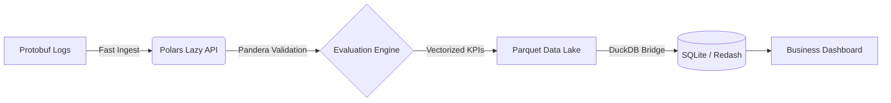
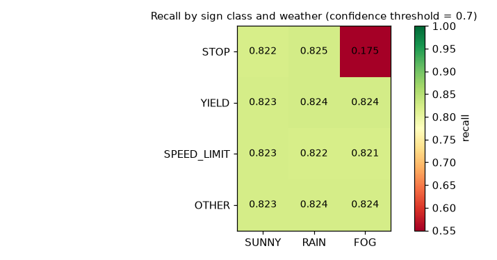
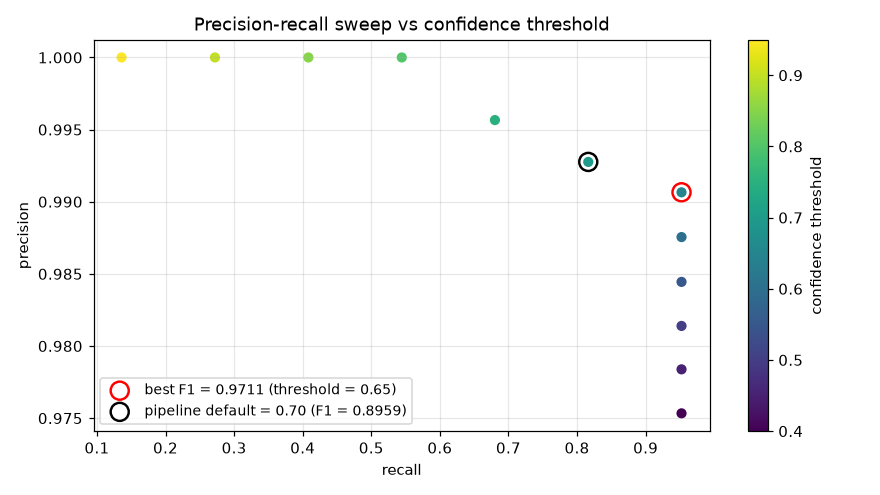
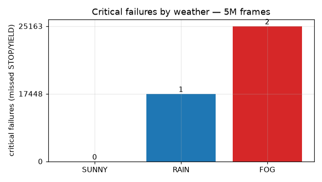
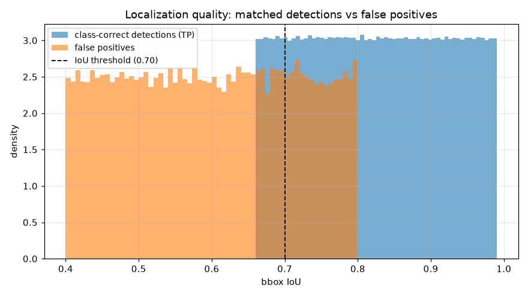
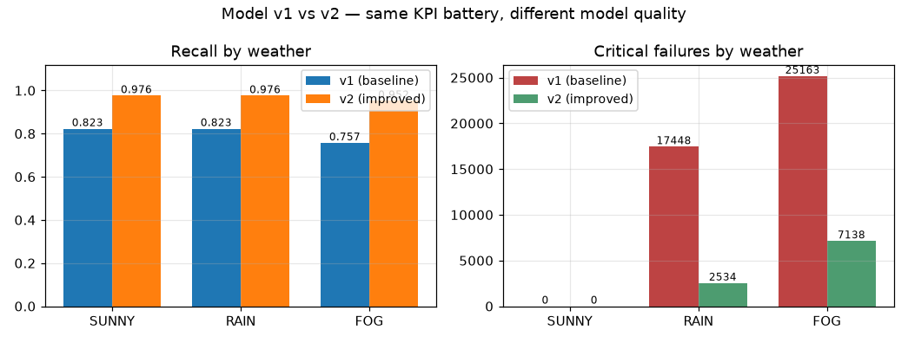
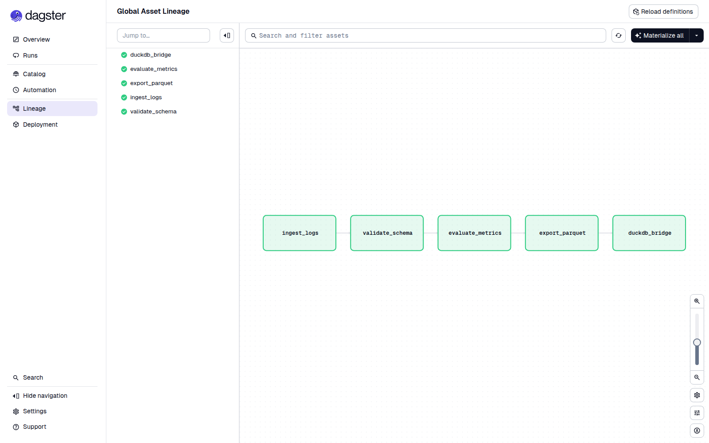
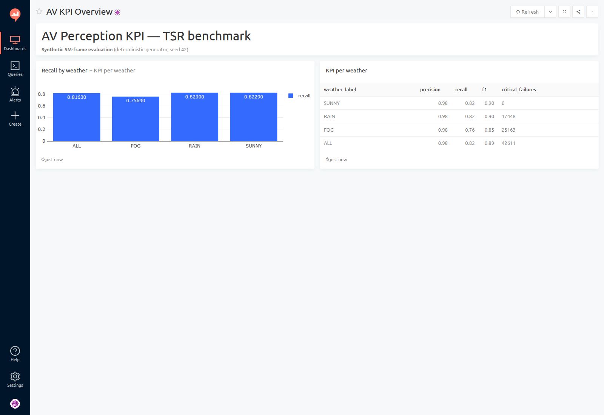

# AV Perception KPI Pipeline: Traffic Sign Recognition (TSR)

[](https://github.com/astral-sh/ruff)
[](http://mypy-lang.org/)
[](https://dagster.io/)

A high-performance, asset-driven data pipeline designed for evaluating **Autonomous Vehicle (AV) Vision Models**. This project demonstrates a **Modern Data Stack (2026)** approach to processing and analyzing large-scale perception logs (5M+ records) with extreme efficiency.

## 🚀 The Architecture

This pipeline is built for speed and reliability, moving away from legacy Pandas-based workflows towards a vectorized, binary-first architecture.



### 🛠 Tech Stack
- **Orchestration**: [Dagster](https://dagster.io/) (Software-Defined Assets)
- **Data Processing**: [Polars](https://pola.rs/) (Lazy Evaluation, Rust-based engine)
- **Data Format**: [Protobuf](https://protobuf.dev/) (Binary serialization for 5M+ records)
- **Validation**: [Pandera](https://pandera.readthedocs.io/) (Strict schema enforcement)
- **Analytics Engine**: [DuckDB](https://duckdb.org/) (In-process OLAP)
- **Visualization**: [Redash](https://redash.io/) (Dockerized BI layer)
- **Tooling**: `uv` (Package management), `ruff` (Linting), `mypy` (Type safety)

## 💡 Key Technical Highlights

- **Binary Serialization**: Uses Protobuf to handle high-frequency sensor data, reducing storage footprint and ingest time compared to JSON/CSV.
- **Zero-Loop Processing**: Implements 100% vectorized logic using Polars' expressions (`pl.when().then()`). No Python `for` loops or `.apply()` calls.
- **Lazy Evaluation**: Queries are optimized by Polars' query engine before execution, ensuring minimal memory usage even on commodity hardware.
- **Safety-First KPIs**: Specialized logic to detect **Critical Failures** (e.g., missed STOP signs in adverse weather conditions like FOG/RAIN).
- **OLAP Bridge**: Uses DuckDB to bridge the gap between the Parquet Data Lake and the BI layer, enabling high-speed aggregations without a dedicated database server.

## 📊 Key Results (synthetic benchmark, 5M frames)

Evaluated with the **effective-prediction rule**: a prediction with `confidence < 0.7`
is treated as no detection. Full analysis with charts: [notebooks/exploration.ipynb](notebooks/exploration.ipynb).

| Segment | Frames | Precision | Recall | F1 | Avg IoU (TP) | Critical failures |
|---|---:|---:|---:|---:|---:|---:|
| **ALL** | 5,000,000 | 0.9832 | 0.8163 | 0.8920 | 0.8249 | 42,611 |
| SUNNY | 3,500,259 | 0.9834 | 0.8229 | 0.8960 | 0.8249 | 0 |
| RAIN | 999,653 | 0.9830 | 0.8230 | 0.8959 | 0.8249 | 17,448 |
| FOG | 500,088 | 0.9820 | 0.7569 | 0.8549 | 0.8251 | 25,163 |

**Headline finding:** fog collapses STOP-sign recall to **0.175** (vs ~0.82 in sunny
weather) while precision stays ~0.98 — exactly the safety-critical failure mode this
pipeline is built to surface. Every critical failure happens in rain or fog.

**Localization:** matched detections average IoU **0.825**; ~12% of matches fall below
the 0.70 IoU threshold (`is_poor_localization` — box quality is a first-class KPI,
independent of weather in this benchmark).









The threshold sweep shows the F1-optimal threshold for this synthetic model is **0.60**
(F1 0.970) — making the acceptance threshold an explicit, measurable policy decision
instead of a hidden constant.

### Model A/B comparison

`scripts/compare_models.py` runs the **identical KPI battery** against two model
profiles (same deterministic generator, different quality parameters), turning
model improvements into numbers:

| Model | Precision | Recall | F1 | Critical failures |
|---|---:|---:|---:|---:|
| v1 (baseline) | 0.9832 | 0.8163 | 0.8920 | 42,611 |
| **v2 (improved)** | **0.9929** | **0.9736** | **0.9832** | **9,672 (−77%)** |



## 🖥️ Orchestration & BI in Action

The full stack running locally — Dagster global asset lineage (all assets
materialized, quality checks green) and the Redash dashboard provisioned
end-to-end via REST API (`./scripts/redash_provision.sh`):





## ⚡ Performance

Measured on AMD Ryzen AI MAX+ PRO 395, Linux, Python 3.12 (single local run,
`uv run python scripts/benchmark.py`):

| Step | Time |
|---|---:|
| Generator: 5M records → Protobuf | 4.99 s |
| Ingest: Protobuf → Polars DataFrame (5M) | 3.60 s |
| KPI flags (`compute_kpi_flags`, 5M rows) | 0.03 s |
| Pipeline end-to-end (ingest → validation → KPI → Parquet → SQLite) | 6.23 s |
| Unit tests (pytest, 37 tests) | 0.92 s |

The whole pipeline — 5M frames in, BI-ready SQLite report out — runs in about six
seconds, single process, no cluster.

## 🚦 Getting Started

### 1. Prerequisites
Ensure you have `uv` and Docker (Compose v2) installed.

### 2. Installation
```bash
uv sync
```

### 3. Generate Mock Data (5M Records)
```bash
uv run python generator.py
```

### 4. Run the Pipeline
```bash
# One-shot headless run (recommended for a quick start)
uv run python demo_run.py

# Or explore the asset graph in the Dagster UI
uv run python -m dagster dev
```
Navigate to [http://localhost:3000](http://localhost:3000) to see the Asset Graph.

### 5. Launch Visualization
```bash
docker compose up -d
./scripts/redash_setup.sh       # init DB + register the SQLite data source
./scripts/redash_provision.sh   # service account + saved query + dashboard via API
```
Access the dashboard at [http://localhost:5000/dashboard/av-kpi-overview](http://localhost:5000/dashboard/av-kpi-overview)
(login `demo@av.local` / `av-demo-2026`, or create your own admin account).
Details and alternatives: [docs/runbook.md](docs/runbook.md).

## 🛡️ Quality Assurance
The project follows strict engineering standards:
```bash
# Run formatting, linting, type checking and unit tests
./scripts/lint.sh
```
CI runs the same checks on every push: `.github/workflows/ci.yml`.

---
*Created as a demonstration of advanced Data Engineering & MLOps patterns for 2026.*