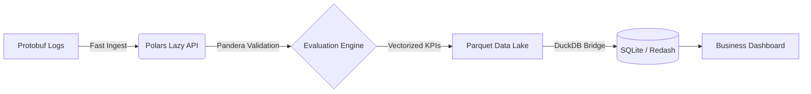

# AV Perception KPI Pipeline: Traffic Sign Recognition (TSR)

[](https://github.com/astral-sh/ruff)
[](http://mypy-lang.org/)
[](https://dagster.io/)

A high-performance, asset-driven data pipeline designed for evaluating **Autonomous Vehicle (AV) Vision Models**. This project demonstrates a **Modern Data Stack (2026)** approach to processing and analyzing large-scale perception logs (5M+ records) with extreme efficiency.

## 🚀 The Architecture

This pipeline is built for speed and reliability, moving away from legacy Pandas-based workflows towards a vectorized, binary-first architecture.



### 🛠 Tech Stack
- **Orchestration**: [Dagster](https://dagster.io/) (Software-Defined Assets)
- **Data Processing**: [Polars](https://pola.rs/) (Lazy Evaluation, Rust-based engine)
- **Data Format**: [Protobuf](https://protobuf.dev/) (Binary serialization for 5M+ records)
- **Validation**: [Pandera](https://pandera.readthedocs.io/) (Strict schema enforcement)
- **Analytics Engine**: [DuckDB](https://duckdb.org/) (In-process OLAP)
- **Visualization**: [Redash](https://redash.io/) (Dockerized BI layer)
- **Tooling**: `uv` (Package management), `ruff` (Linting), `mypy` (Type safety)

## 💡 Key Technical Highlights

- **Binary Serialization**: Uses Protobuf to handle high-frequency sensor data, reducing storage footprint and ingest time compared to JSON/CSV.
- **Zero-Loop Processing**: Implements 100% vectorized logic using Polars' expressions (`pl.when().then()`). No Python `for` loops or `.apply()` calls.
- **Lazy Evaluation**: Queries are optimized by Polars' query engine before execution, ensuring minimal memory usage even on commodity hardware.
- **Safety-First KPIs**: Specialized logic to detect **Critical Failures** (e.g., missed STOP signs in adverse weather conditions like FOG/RAIN).
- **OLAP Bridge**: Uses DuckDB to bridge the gap between the Parquet Data Lake and the BI layer, enabling high-speed aggregations without a dedicated database server.

## 🚦 Getting Started

### 1. Prerequisites
Ensure you have `uv` and `docker-compose` installed.

### 2. Installation
```bash
uv sync
```

### 3. Generate Mock Data (5M Records)
```bash
uv run python3 generator.py
```

### 4. Run the Pipeline
```bash
# Start the Dagster Dev Server
uv run python3 -m dagster dev
```
Navigate to [http://localhost:3000](http://localhost:3000) to see the Asset Graph.

### 5. Launch Visualization
```bash
docker-compose up -d
```
Access the dashboard at [http://localhost:5000](http://localhost:5000).

## 🛡️ Quality Assurance
The project follows strict engineering standards:
```bash
# Run formatting, linting, and type checking
./scripts/lint.sh
```

---
*Created as a demonstration of advanced Data Engineering & MLOps patterns for 2026.*